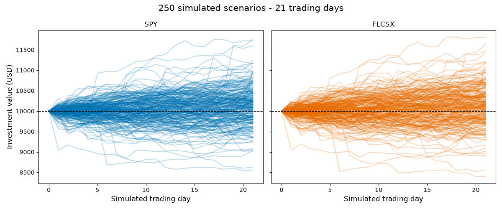
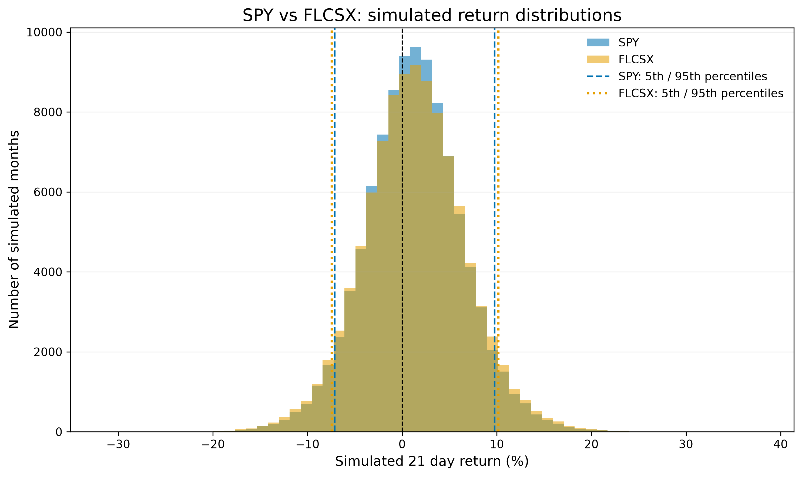

# Monte Carlo Simulation: SPY vs FLCSX

## 1. Project Overview

This project investigates the relative performance of two investment instruments:

- **SPY:** SPDR S&P 500 ETF Trust, an exchange-traded fund tracking the S&P 500.
- **FLCSX:** Fidelity Large Cap Stock Fund, an actively managed mutual fund.

Using an independent bootstrap of historical daily returns, the analysis simulates **100,000 monthly return scenarios**, each consisting of 21 randomly sampled trading days with replacement.

For each simulated trading day, SPY and FLCSX returns are drawn from the same historical date, preserving the relationship between the two funds under matched market conditions.

The objective is to examine how frequently FLCSX outperforms SPY and characterize the distribution of their simulated monthly performance differences.

## 2. Research Question

**How frequently does FLCSX outperform SPY over a simulated 21-trading-day month, and how variable are the differences in their returns?**

Rather than comparing only historical average returns, the project examines the distribution of possible monthly outcomes generated by resampling observed market conditions.

This provides additional information about the consistency and variability of relative performance.

## 3. Data and Methodology

### Historical Data

The analysis uses historical daily returns for SPY and FLCSX over the period **January 2016 – November 2026**.

The two return series are aligned by trading date to ensure that each observation represents the same historical market conditions.

### Bootstrap Simulation

The simulation follows these steps:

1. Construct a dataset containing paired daily returns for SPY and FLCSX.
2. Independently sample 21 historical trading dates with replacement to represent one hypothetical trading month.
3. Use the same sampled dates for both funds, preserving their contemporaneous return relationships.
4. Calculate each fund's cumulative return over the simulated month.
5. Calculate the difference between the two monthly returns.
6. Repeat the procedure 100,000 times to obtain an empirical distribution of monthly performance differences.

This approach is a **paired independent bootstrap**, since the daily returns of the two funds remain paired while observations are independently resampled across trading days.

## 4. Results

The simulation produced the following results across 100,000 hypothetical monthly scenarios:

| Metric | Result |
| Number of simulated months | 100,000 |
| Trading days per simulated month | 21 |
| FLCSX wins 50365 times |
| FLCSX performance: | 50.4% |
| Average returns SPY: | 1.27% |
| Average returns FLCSX: | 1.31% |
| Average gap: | 0.039 percentage points |
| Gap 5th percentile: | -2.626 percentage points |
| Gap 95th percentile: | 2.779 percentage points |
| SPY standard deviation: | 5.18 percentage points |
| FLCSX standard deviation: | 5.39 percentage points |
| SPY 5th percentile: | -7.127 percentage points |
| SPY 95th percentile: | 9.799 percentage points |
| FLCSX 5th percentile: | -7.426 percentage points |
| FLCSX 95th percentile: | 10.199 percentage points |

### Sample of the investment path for 250 months

### Distribution of Simulated Monthly Returns

### Interpretation

FLCSX outperformed SPY in approximately 50.4% of the simulated monthly scenarios.

The average simulated monthly performance difference was approximately 0.039 percentage points in favor of FLCSX.

However, the relatively balanced outperformance frequency suggests that FLCSX did not consistently outperform SPY across the simulated months. FLCSX has a slightly wider distrubution, indicated by a larger standard deviation and interquartile ranges. This explains a larger volatility of FLCSX across the simulation that could be associated to a graeater risk from an investor perspective

The distribution of performance differences also demonstrates that relative returns can vary considerably across different combinations of historical market observations.

These findings describe the behavior of the bootstrap simulation and do not establish that FLCSX has a statistically significant performance advantage.

## 5. Statistical Assumptions and Limitations

### Independent Daily Sampling

Each simulated trading day is sampled independently from the historical dataset.

Consequently, the simulation does not preserve the original chronological sequence of market returns.

This means that time-dependent characteristics, such as volatility clustering and serial dependence, may not be accurately reproduced.

### Historical Data Dependence

The simulations are constructed entirely from historical observations.

They therefore reflect the empirical distribution of returns within the selected historical period rather than providing an independent forecast of future market performance.

### Simplified Trading Month

Each simulated month contains exactly 21 trading days.

Actual calendar months can contain different numbers of trading sessions.

### Statistical Inference

The empirical percentiles describe the distribution of simulated monthly performance differences.

They should not be interpreted as confidence intervals for the true difference in expected returns without an appropriate statistical inference procedure.

### Other Considerations

The analysis depends on the consistency and accuracy of the historical return data.

Differences in dividend treatment, fund distributions, adjusted prices and trading calendars could affect the comparison.

## 6. Technologies Used

- **Python:** Simulation implementation and statistical analysis.
- **NumPy:** Numerical computations, random sampling and array operations.
- **Matplotlib** For graphical visualization of the data. 

Additional libraries and dependencies are documented in the Python source code.

## 7. Conclusion

This project uses paired historical-return resampling to compare the monthly performance of SPY and FLCSX under matched market conditions.

Across 100,000 simulated months, FLCSX outperformed SPY approximately half of the time and exhibited a small positive average return difference.

The results illustrate the importance of considering the entire distribution of relative performance rather than relying exclusively on average returns.

More broadly, the project provides a practical application of probability, bootstrap simulation and statistical analysis to financial data.
